# IP Finder

A desktop IP address lookup application built with **Java**, **JavaFX**, and **Spring Boot**.

The application allows users to:

- Validate IPv4 and IPv6 addresses
- Retrieve geographical and network information for an IP address
- Display country, city, ISP, and related information
- Maintain a local lookup history
- Persist history in a JSON file
- Perform network and file operations in background threads
- Navigate between Lookup and History views

---

## Features

### IP Lookup

Enter an IPv4 or IPv6 address and retrieve information from the configured GeoIP service.

The application displays:

- IP address
- Country
- City
- ISP

The underlying API response also supports:

- Country code
- Region
- ZIP code
- Latitude
- Longitude
- Timezone
- Organization
- ASN

### IP Validation

The application validates:

- IPv4 addresses
- IPv6 addresses
- Empty or blank input

Invalid input is rejected before making an external API request.

### Lookup History

Every successful lookup is stored locally.

History entries contain:

- IP address
- Country
- City
- ISP
- Lookup timestamp

The history is limited by the configured maximum number of entries.

### JSON Persistence

Lookup history is persisted to a JSON file.

Default location:

```text
~/.ipfinder/history.json
```

The location and maximum number of entries can be configured through application properties.

### Background Processing

Network requests and file operations are executed outside the JavaFX Application Thread.

This keeps the user interface responsive while:

- Calling the GeoIP API
- Loading history
- Saving history

---

# Technology Stack

| Technology | Purpose |
|---|---|
| Java 21 | Application language |
| JavaFX | Desktop UI |
| Spring Boot | Dependency injection and application configuration |
| Java `HttpClient` | HTTP communication |
| Jackson | JSON serialization/deserialization |
| Maven | Build and dependency management |
| ip-api.com | GeoIP lookup provider |

---

# Architecture

The project follows a lightweight layered architecture.

```text
com.app.ipfinder
│
├── Launcher.java
├── IpFinderApplication.java
│
├── config/
│   ├── AppConfig.java
│   └── IpFinderProperties.java
│
├── ui/
│   ├── StageManager.java
│   └── controller/
│       ├── MainController.java
│       ├── LookupController.java
│       └── HistoryController.java
│
├── service/
│   ├── IpLookupService.java
│   ├── HistoryService.java
│   └── IpValidator.java
│
├── client/
│   ├── GeoIpClient.java
│   └── IpApiGeoIpClient.java
│
├── storage/
│   ├── HistoryStore.java
│   └── JsonFileHistoryStore.java
│
├── model/
│   ├── IpInfo.java
│   └── LookupEntry.java
│
└── exception/
    ├── InvalidIpException.java
    ├── LookupFailedException.java
    └── HistoryStoreException.java
```

---

# Architecture Overview

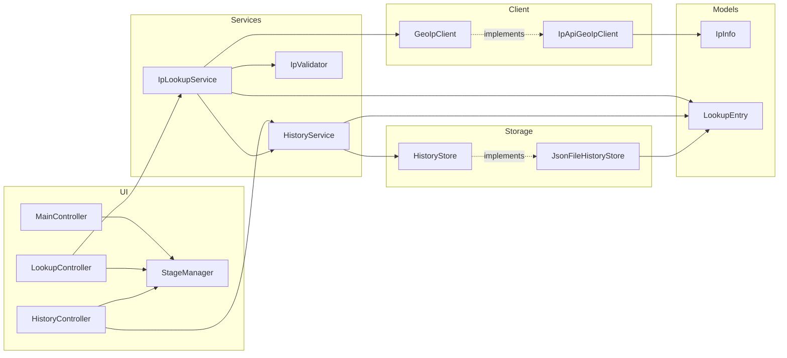

---

# Application Startup

The application starts JavaFX through `Launcher`, initializes the Spring ApplicationContext, creates the required services and components, and finally displays the main window.

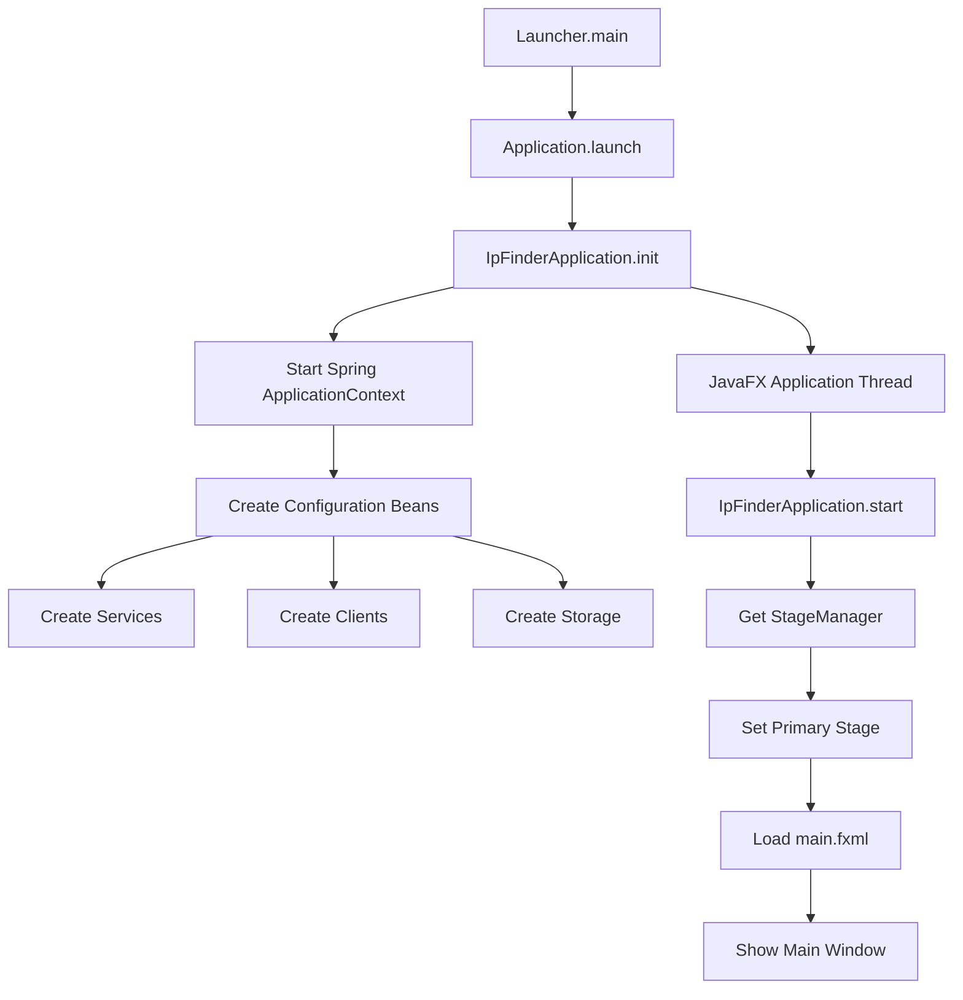

---

# Main Window Navigation

The main window contains the application navigation and a content area.

The user can switch between:

- IP Lookup
- Lookup History

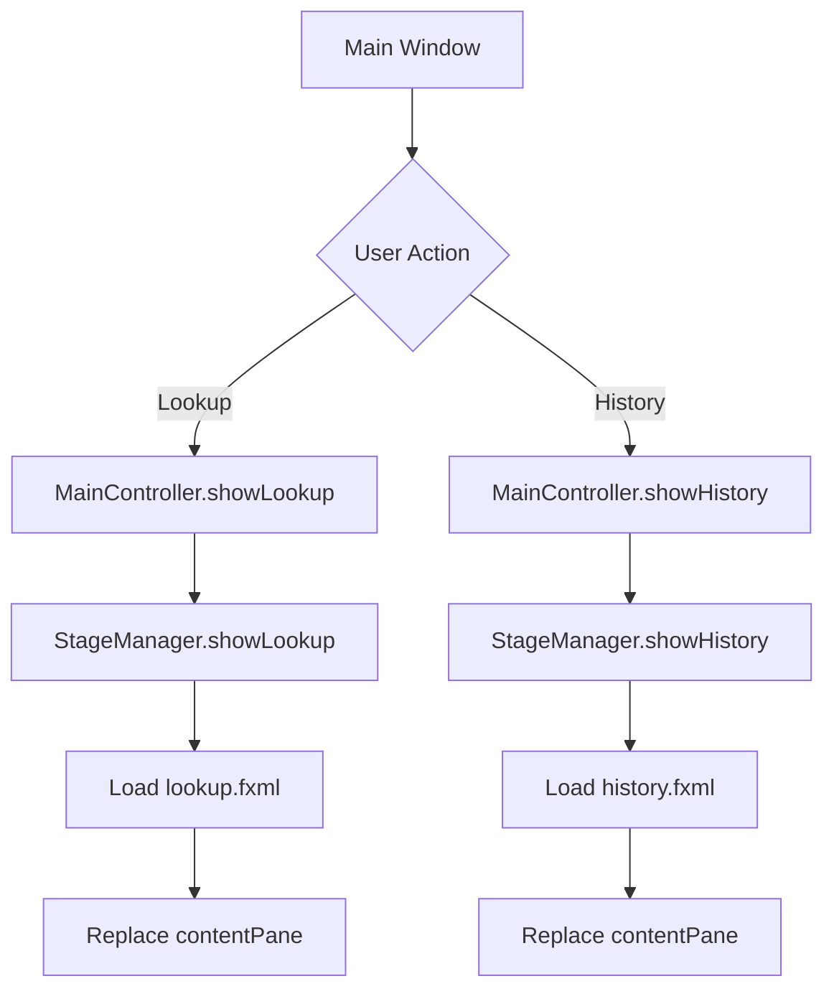

---

# IP Lookup Flow

The lookup operation is performed asynchronously using a JavaFX `Task` and the application's background executor.

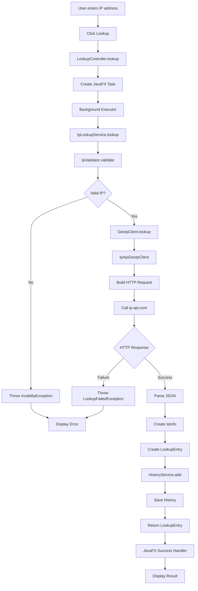

---

# IP Validation

The application validates the input before contacting the external API.

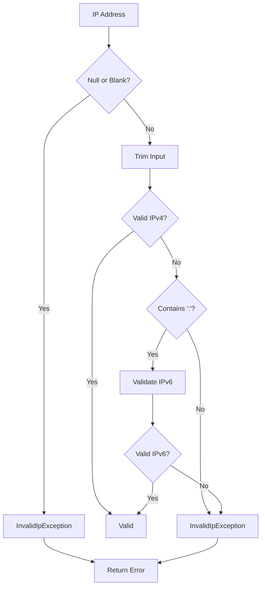

---

# GeoIP API Communication

The application uses `GeoIpClient` as an abstraction for external IP lookup providers.

The current implementation is:

```text
IpApiGeoIpClient
```

The client uses Java's `HttpClient` to communicate with the configured GeoIP API.

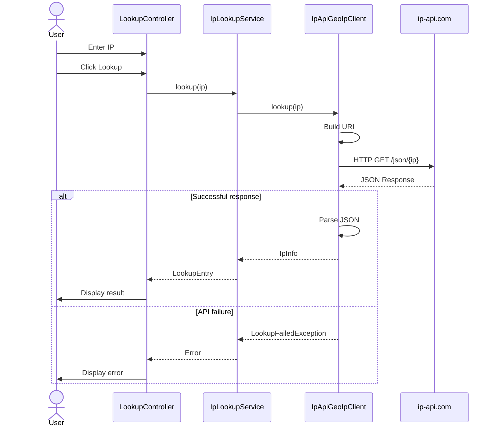

---

# Lookup and History

A successful lookup is converted from `IpInfo` into a `LookupEntry`.

The entry is then added to the application's history.

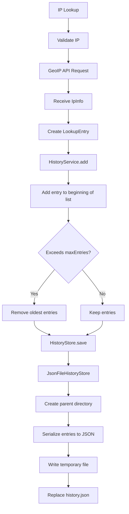

---

# History Loading

When `HistoryService` is created, it loads previously stored lookup entries.

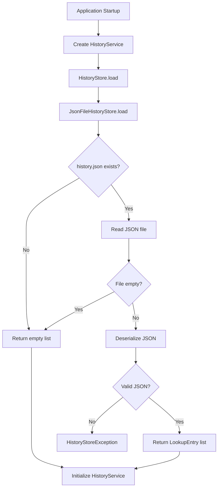

---

# History Page

The History page displays stored lookup entries in a JavaFX `TableView`.

Users can:

- Refresh the history
- Clear the history

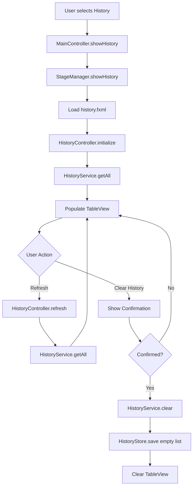

---

# Clear History

Clearing history requires user confirmation before the stored entries are removed.

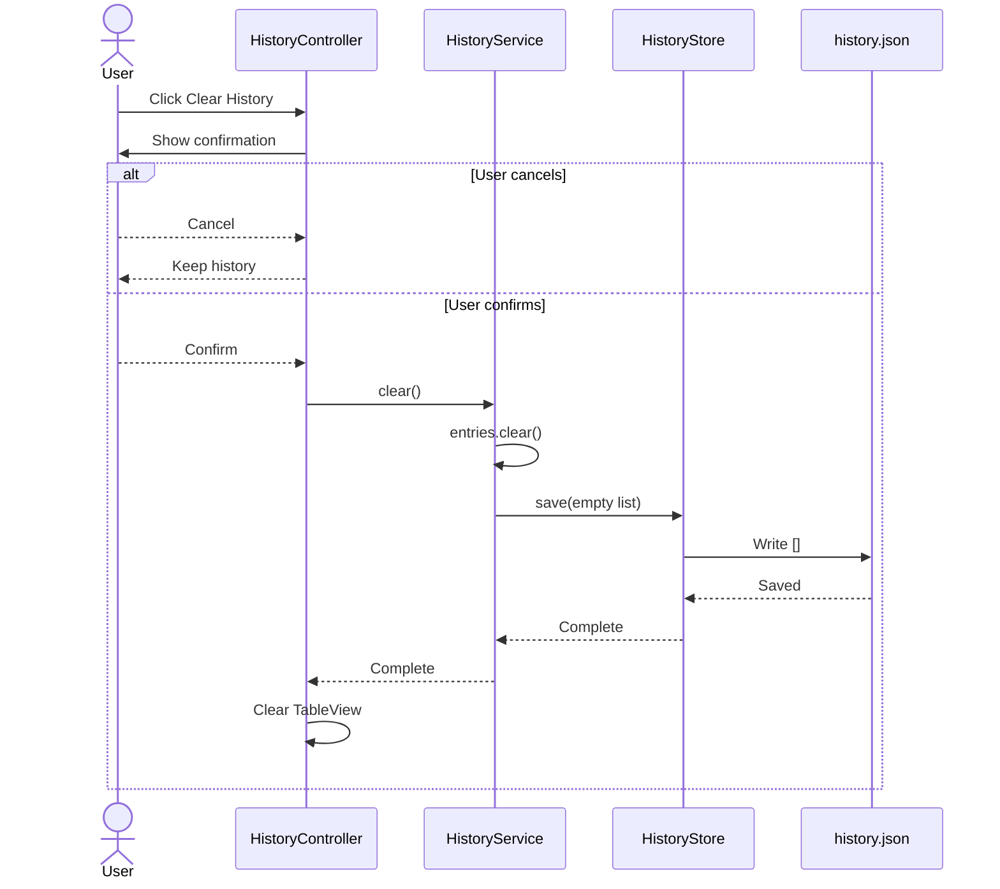

---

# Error Handling

The application uses custom runtime exceptions to distinguish common failures.

| Exception | Purpose |
|---|---|
| `InvalidIpException` | Invalid IPv4/IPv6 input |
| `LookupFailedException` | External API/network/lookup failure |
| `HistoryStoreException` | History file read/write/serialization failure |

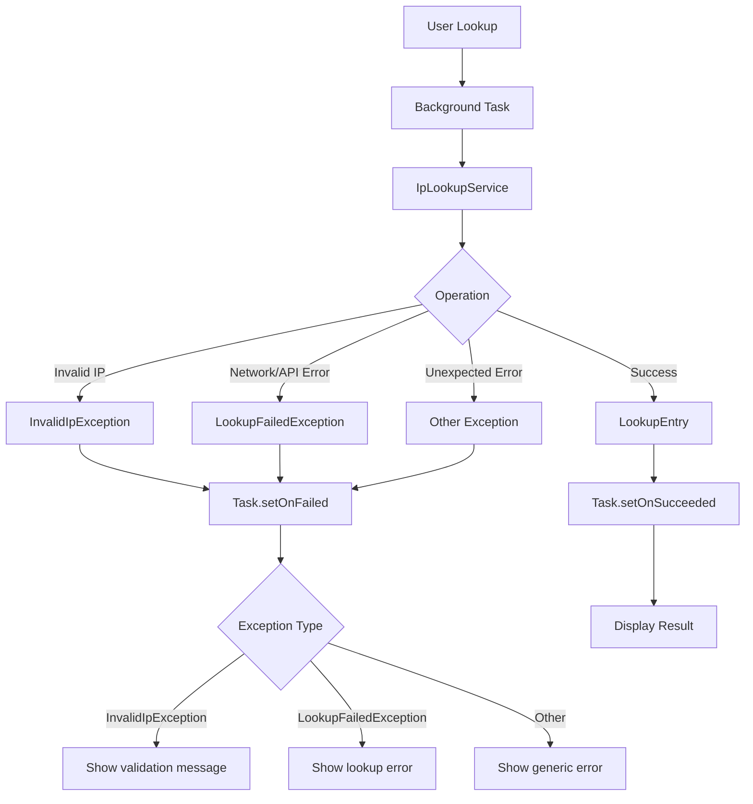

---

# Threading Model

JavaFX requires UI updates to happen on the JavaFX Application Thread.

Network and file operations are therefore executed through the background executor.

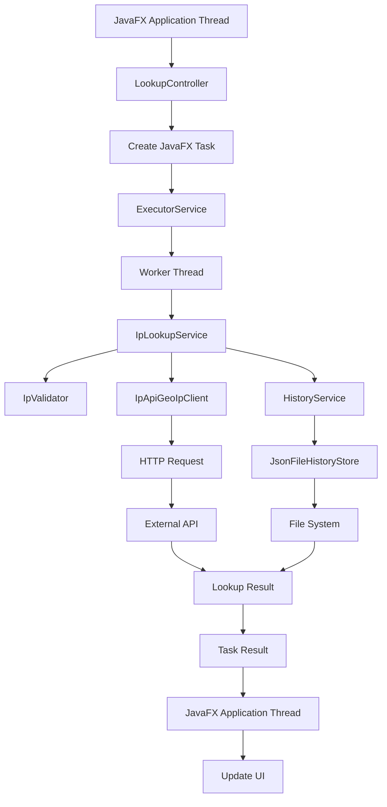

The background executor uses a fixed thread pool:

```text
ipfinder-worker-1
ipfinder-worker-2
ipfinder-worker-3
ipfinder-worker-4
```

---

# Complete System Flow

The complete application flow can be summarized as follows:

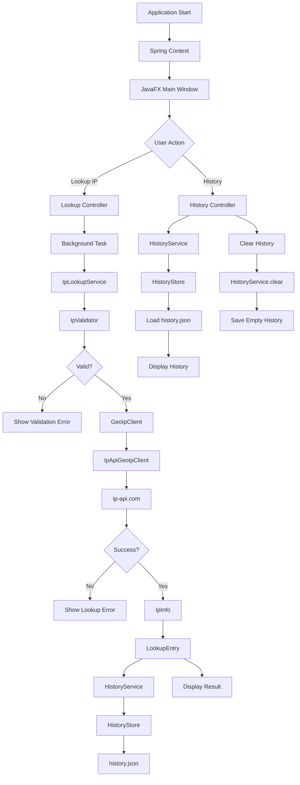

---

# Configuration

Application configuration is represented by `IpFinderProperties`.

Example configuration:

```yaml
ipfinder:
  api:
    base-url: http://ip-api.com/json/
    timeout: 5s

  history:
    file: ${user.home}/.ipfinder/history.json
    max-entries: 200
```

The configuration controls:

- GeoIP API base URL
- HTTP timeout
- History file location
- Maximum number of history entries

---

# Dependency Injection

Spring manages the application's major components.

The dependency flow is:

```text
MainController
    │
    └── StageManager

LookupController
    │
    └── IpLookupService
            ├── IpValidator
            ├── GeoIpClient
            │     └── IpApiGeoIpClient
            └── HistoryService
                    └── HistoryStore
                          └── JsonFileHistoryStore

HistoryController
    │
    └── HistoryService
```

Constructor injection is used throughout the application.

---

# Design Principles

The project follows several practical design principles.

## Separation of Concerns

Each layer has a focused responsibility.

```text
Controller
    ↓
Service
    ↓
Client / Storage
    ↓
External API / File System
```

Controllers do not directly access:

- HTTP clients
- JSON files
- Persistence implementations

---

## Interface-Based Design

External dependencies are abstracted through interfaces.

### GeoIP

```java
public interface GeoIpClient {
    IpInfo lookup(String ip);
}
```

Implementation:

```text
IpApiGeoIpClient
```

### History Storage

```java
public interface HistoryStore {
    List<LookupEntry> load();
    void save(List<LookupEntry> entries);
}
```

Implementation:

```text
JsonFileHistoryStore
```

This makes it possible to replace the API provider or storage mechanism without changing the service layer.

---

# Data Models

## IpInfo

Represents information returned by the GeoIP provider.

```text
IpInfo
├── status
├── message
├── query
├── country
├── countryCode
├── regionName
├── city
├── zip
├── lat
├── lon
├── timezone
├── isp
├── org
└── asInfo
```

## LookupEntry

Represents a history record.

```text
LookupEntry
├── ip
├── country
├── city
├── isp
└── timestamp
```

---

# Project Flow

At a high level:

```text
User
 │
 ▼
JavaFX UI
 │
 ▼
Controller
 │
 ▼
Service
 │
 ├──────────────► Validator
 │
 ├──────────────► GeoIP Client ─────► External API
 │
 └──────────────► History Service
                       │
                       ▼
                  History Store
                       │
                       ▼
                  JSON File
```

---

# Running the Application

## Requirements

Install:

- JDK 21
- Maven
- JavaFX-compatible runtime/dependencies

Verify Java:

```bash
java -version
```

Verify Maven:

```bash
mvn -version
```

## Build

```bash
mvn clean package
```

## Run

```bash
mvn spring-boot:run
```

If the project is packaged as an executable application:

```bash
java -jar target/ip-finder.jar
```

---

# Configuration File

Create or modify:

```text
src/main/resources/application.yml
```

Example:

```yaml
spring:
  application:
    name: ip-finder

ipfinder:
  api:
    base-url: http://ip-api.com/json/
    timeout: 5s

  history:
    file: ${user.home}/.ipfinder/history.json
    max-entries: 200
```

---

# History File

The history is stored locally as JSON.

Example:

```json
[
  {
    "ip": "8.8.8.8",
    "country": "United States",
    "city": "Mountain View",
    "isp": "Google LLC",
    "timestamp": "2026-10-16T10:30:00Z"
  }
]
```

---

# Error Scenarios

The application handles common failure cases:

### Invalid IP

```text
Please enter a valid IPv4 or IPv6 address.
```

### Network Failure

```text
Could not reach the lookup service.
```

### API Failure

```text
Lookup failed: <reason>
```

### Rate Limiting

If the external API returns HTTP `429`:

```text
Too many requests. Please wait a minute and try again.
```

### Corrupted History

If the local JSON file cannot be parsed:

```text
Could not read lookup history.
The history file may be corrupted.
```

---

# Future Improvements

Possible future enhancements include:

- Multiple GeoIP provider implementations
- Country flags
- Map visualization
- Detailed IP information view
- Search/filter history
- Export history to CSV
- Delete individual history records
- Dark mode
- Configurable API providers
- Unit and integration tests
- API response caching
- Automatic retry with backoff
- Offline/local IP database support

---

# License

This project is intended for educational and development purposes.

Add an appropriate license file if the project is distributed publicly.